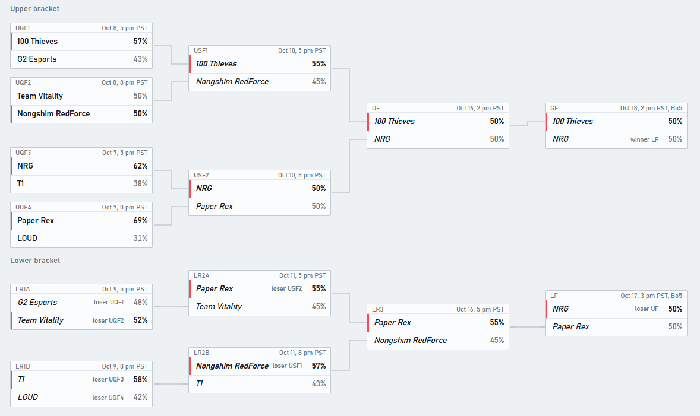

# VCT Champions 2026 playoff predictor

A mini project that turns about 18 months of Valorant match data into title odds for the eight teams in the Valorant Champions 2026 playoffs (double elimination, Oct 7 to 18, 2026).

It rates every team from past results and player stats, estimates the chance that any team beats any other, then replays the playoff bracket 20,000 times to count how often each team wins.



## Forecast

Made before any playoff results were entered. The blend column is the headline model.

| Team | Elo only | Elo + player rating | **Blend** |
|---|---|---|---|
| Paper Rex | 18.7% | 22.1% | **20.6%** |
| NRG | 18.0% | 21.2% | **19.9%** |
| 100 Thieves | 22.6% | 13.7% | **18.0%** |
| Team Vitality | 8.3% | 15.9% | **11.8%** |
| Nongshim RedForce | 13.5% | 9.3% | **11.6%** |
| G2 Esports | 7.9% | 11.6% | **9.8%** |
| T1 | 8.6% | 3.7% | **5.7%** |
| LOUD | 2.5% | 2.6% | **2.7%** |

How to read it:

- Paper Rex, NRG and 100 Thieves are effectively tied. The gaps between them are smaller than the uncertainty in the model, so their order means little.
- Vitality, Nongshim and G2 form a middle group. T1 is low, and LOUD is the long shot.
- The two ingredient models disagree most on 100 Thieves (13.7% to 22.6%) and Vitality (8.3% to 15.9%). Elo rates teams on results, and the player model rates them on individual performance.
- A 20% title chance means roughly one win in five replays. Even a perfect model would give the favorite only about 25% in this format, so flat odds are expected.

## How it works

1. **Data.** Match results, map scores and per-player stats from [VLR.gg](https://www.vlr.gg), collected through the unofficial `vlrdevapi` package. 4,999 matches were collected (March 2025 to Oct 4, 2026), and 1,107 from events the eight teams played were used. That is 3,261 maps and 11,078 player stat lines.
2. **Elo ratings.** Every team starts at 1500 and gains or loses points after each match, depending on how surprising the result was (K = 24). Every prediction is made before its own result is used.
3. **Player rating.** For each match, the average past rating of the five players who actually played. Players with few series are pulled toward the overall average, so one hot series does not inflate a newcomer. Because it follows the players, roster changes show up automatically.
4. **Match model.** A logistic regression on the Elo difference and the player-rating difference. The headline model is a 50/50 blend of the Elo-only and the Elo + player probabilities, used as a hedge because the player feature is not statistically proven (see below).
5. **Bracket simulation.** Each series is a weighted coin flip using the model's win chance. Winners and losers move through the real double-elimination bracket, 20,000 times per model with identical random draws. A team's title odds are the share of runs it wins. A matchup at 50% is a pure coin flip in the simulation, and the odds average over both outcomes.

## How it was tested

All tests are walk-forward: train on older matches, test on the next chunk, repeat (620 test matches after a 30% warm-up). Nothing is shuffled, so the model never sees the future. Settings were fixed before looking at results, and a feature counted as better only if its gain over the Elo baseline was positive and larger than its margin of error.

Scores use accuracy and log-loss. Log-loss rewards well-calibrated probabilities, and lower is better (0.693 is a coin flip).

| Model | Accuracy | Log-loss | Gain vs Elo baseline |
|---|---|---|---|
| Elo (baseline) | 61.3% | 0.665 | none |
| Elo + player rating | 61.9% | 0.655 | +0.0097 ± 0.0146 |
| 50/50 blend | 61.5% | 0.656 | +0.0087 ± 0.0074 |

The blend is the only variant whose gain beat its margin of error in every test slice (all matches, international events only, Bo3 and Bo5 only). Those slices overlap, and accuracy barely moved, so treat this as modest evidence and not a confirmed improvement. On the 96 international test matches the blend scored 70.8%, but that sample is small.

### What did not work

- **Map-pool features** (per-map win rates, quarterly and from individual maps). Worse than Elo alone: 0.673 against 0.666 for the quarterly version, and 0.668 against 0.665 for map-level Elo. A team has only 3 to 8 games per map per quarter, which is too little to separate skill from noise.
- **Score margin and time decay in Elo.** A setting chosen on one half of the test data was slightly worse on the other half (-0.0026 ± 0.0087).

These negative results are kept in `experiments/`.

## Limitations

- About 600 test matches cannot confirm an improvement of 0.01 log-loss. Doing so reliably would take roughly five times the data.
- One tournament cannot validate a probability forecast. A 20% favorite loses four times out of five.
- Player ratings are not adjusted for opponent strength, and the eight teams' ratings are bunched closely together, so small gaps move the probabilities a lot.
- The model treats Bo3 and Bo5 series alike, ignores map picks, and has no bracket reset in the grand final.
- The lower-bracket pairing is assumed (the upper-semifinal losers cross over). Testing the alternative moved any team's odds by at most 0.6 points.
- Ratings are frozen at pre-playoff values. Odds update during the event only through who is still alive and where they sit in the bracket.
- LOUD signed a new player in July 2026, so its history is thin and its rating may lag the current lineup.

## Run it

```bash
python -m venv .venv
source .venv/Scripts/activate      # Windows (Git Bash); on Mac/Linux use .venv/bin/activate
pip install -r requirements.txt

python scrape.py                   # match list -> data/matches.csv
python download_series.py          # maps and player stats (about 2 hours, cached and resumable)
python evaluate.py                 # walk-forward tests
python final.py                    # win chances for every pair and the title odds
python live.py                     # bracket page with played results locked in
```

Run everything from the project root, since the scripts use relative `data/` paths. Re-running later pulls newer matches, so the numbers will differ slightly from the table above.

### Updating during the event

Add one line per finished match to `data/results.csv`, then run `python live.py` and open `data/live_bracket.html`:

```
match,winner
UQF3,NRG
UQF4,Paper Rex
```

Match codes are `UQF1` to `UQF4`, `USF1`, `USF2`, `UF`, `LR1A`, `LR1B`, `LR2A`, `LR2B`, `LR3`, `LF` and `GF`. Short names such as `prx`, `ns`, `vit`, `100t` and `g2` work too. A result that cannot happen stops the script with a message saying what to fix.

## Project structure

```
scrape.py             match list from VLR.gg
download_series.py    map and player stats per match (cached)
features.py           Elo and player-rating features
evaluate.py           walk-forward test harness
final.py              trains the models, builds win chances and title odds
live.py               bracket simulation with results locked in, writes the bracket page
elo.py                the original Elo baseline
checks/               data sanity checks
experiments/          the ideas that did not help
predictions/          forecasts saved before the event
data/                 results.csv, pair_probs_final.csv, bracket page and odds tables
docs/                 screenshots
```

## Data and credits

Data comes from VLR.gg through `vlrdevapi`, an unofficial package that scrapes the site. Check VLR.gg's terms before redistributing any scraped data. The raw data is not included here and can be regenerated with the scripts above. This project is not affiliated with or endorsed by Riot Games or VLR.gg, and it is for fun and learning, not betting advice.

Mini project, built October 2026.